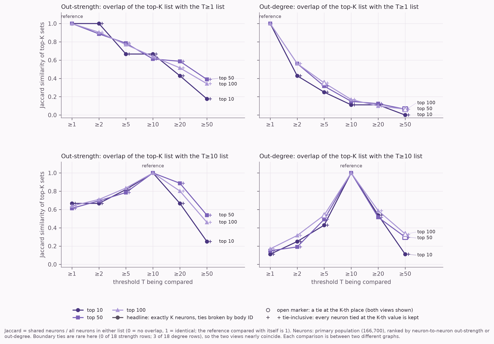
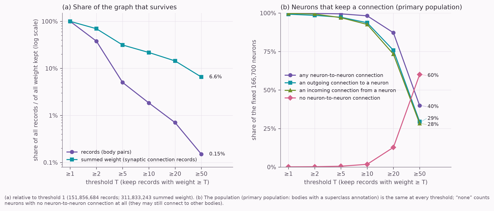
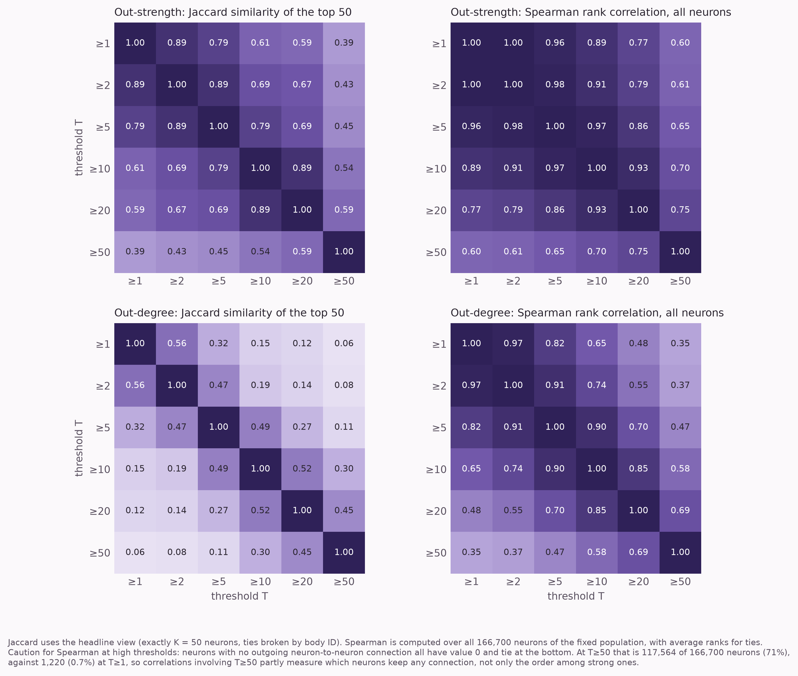

# Fruit Fly Connectome Explorer

**How sensitive is the identification of highly ranked neurons to the connection-weight threshold used to build a fruit fly connectome graph?**

A reproducible Python analysis (pandas, PyArrow, NumPy, Matplotlib) of the **MaleCNS v1.0** connectome. Neurons are ranked by outgoing connectivity after connections below a weight threshold T are discarded, for T in {1, 2, 5, 10, 20, 50}, and the top-ranked lists are compared across thresholds. Each threshold yields a different graph, so this measures how much the ranking depends on that choice. It does not show which neurons are biologically important.

Full write-up: **[docs/report.md](docs/report.md)**. Figure captions and definitions: [outputs/figures/README.md](outputs/figures/README.md).

## Main findings
Descriptive results for this dataset version and these provisional neuron definitions (166,700 annotated bodies); exact values and caveats are in the report.

- Raising T from 1 to 50 keeps **0.15%** of connection records but **6.56%** of the summed weight, and only **39.9%** of the neurons keep any neuron-to-neuron connection.
- Ranking by **out-strength** (summed weight to neuron partners) is moderately stable: top-100 Jaccard similarity against the T≥1 list is 0.905 at T≥2 and 0.342 at T≥50.
- Ranking by **out-degree** (number of distinct neuron partners) is much less stable: 0.562 at T≥2 and 0.064 at T≥50.
- At T≥50, 70.5% of neurons have no outgoing neuron-to-neuron connection and tie at zero, which affects rank correlations at high thresholds.
- Breaking ties at random instead of by body ID changes the top-k Jaccard by at most 0.0070, where a tie at the k-th place exists (out-degree only; 14 of 45 comparisons).







## Method in brief
- **Data.** The MaleCNS v1.0 flat connectome (minconf-0.5): 151,856,684 directed body pairs with a `weight`, which this project reads as the number of synaptic connection records between the pair. Endpoints are segmentation *bodies*, and only 211,577 of 88.4 million have annotations.
- **Populations.** Primary: bodies with a `superclass` annotation. Fully traced subset (a sensitivity analysis, not a better definition): `superclass` present and `status == "Traced"`. Each population is fixed across thresholds.
- **Metrics and comparison.** Out-strength and out-degree to neuron partners; Jaccard similarity of the top 10, 50 and 100, and Spearman correlation. Ties are always reported two ways (body-ID tie-break and tie-inclusive), and a seeded Monte Carlo check estimates the effect of random tie-breaking.
- **Memory.** The 1 GB connection table is streamed once, one record batch at a time, with no full graph in memory.
- **Verification.** Hand-computed unit tests, an independent pandas reference, mutation tests that must fail, and cross-checks between output tables.

## Reproduce the results
Python 3.10 or later is declared in `pyproject.toml`, but the code and tests have been run only on Python 3.14.7. Run from the repository root.

```bash
python3 -m venv .venv && source .venv/bin/activate
pip install -e ".[dev]"
pytest                                   # unit tests; no dataset needed

# 1. Download the data (about 1.1 GB; not stored in this repository)
BASE=https://storage.googleapis.com/flyem-male-cns/v1.0/connectome-data/flat-connectome
ANN=body-annotations-male-cns-v1.0-minconf-0.5.feather
CON=connectome-weights-male-cns-v1.0-minconf-0.5.feather
mkdir -p data/raw
python -m connectome.download $BASE/$ANN data/raw/$ANN
python -m connectome.download $BASE/$CON data/raw/$CON

# 2. Optional: full-file validation (schema, duplicates, weight totals)
python scripts/validate_connections.py data/raw/$CON data/raw/$ANN

# 3. Analysis
python scripts/run_aggregation.py data/raw/$CON data/raw/$ANN   # streaming pass
python scripts/run_stability.py                                 # rankings and stability tables
python scripts/run_tie_sensitivity.py                           # Monte Carlo tie-breaking check
python scripts/make_figures.py                                  # figures and captions
```
Tables are written to `outputs/tables/` and figures to `outputs/figures/`; the files committed here were produced this way. Tested with Python 3.14.7, pandas 3.0.6, pyarrow 26.0.0, numpy 2.5.4 and matplotlib 3.11.2; the older minimum versions declared in `pyproject.toml` have not been tested. The aggregation took about 80 s with a peak of roughly 0.75 to 0.85 GB on the development machine.

## Limitations
- Different thresholds describe different graphs.
- `weight` is a record count whose meaning comes from the data providers' code, not from their prose documentation.
- The neuron definitions are provisional, annotation coverage is incomplete, and the count here (166,700) differs from the preprint's (166,691) for reasons not resolved.
- One dataset version, two metrics, six thresholds. A high rank is not evidence of biological importance or of a causal role.

## Data and attribution
This project analyses the **MaleCNS v1.0** connectome released by the FlyEM Project Team at HHMI Janelia, the Cambridge Drosophila Connectomics Group (University of Cambridge) / MRC Laboratory of Molecular Biology, and Google Research.

- Dataset licence: **Creative Commons Attribution 4.0 International (CC BY 4.0)**, <https://creativecommons.org/licenses/by/4.0/>
- Source: <https://male-cns.janelia.org/download/>
- Preprint: Berg S, Beckett IR, Costa M, Schlegel P, Januszewski M, et al. *Sexual dimorphism in the complete connectome of the Drosophila male central nervous system.* bioRxiv, 9 October 2025. [doi:10.1101/2025.10.09.680999](https://doi.org/10.1101/2025.10.09.680999)
- Tie-breaking background: Corsi M, Urbano J. *The Treatment of Ties in Rank-Biased Overlap.* SIGIR '24, 2024. [doi:10.1145/3626772.3657700](https://doi.org/10.1145/3626772.3657700)
- The data providers publish no recommended citation string, so this credit follows the CC BY 4.0 requirements (creators, licence link, indication of changes). No peer-reviewed journal reference is cited because none has been verified.
- **Changes made:** the data files are used unmodified. The tables and figures here are derived summaries (counts, aggregated degree and strength, rankings) and keep this attribution (see [outputs/README.md](outputs/README.md)).

## Licence
The **code, tests and documentation text** are released under the [MIT Licence](LICENSE). The MIT Licence does **not** apply to the MaleCNS dataset, which remains under its own CC BY 4.0 licence.
